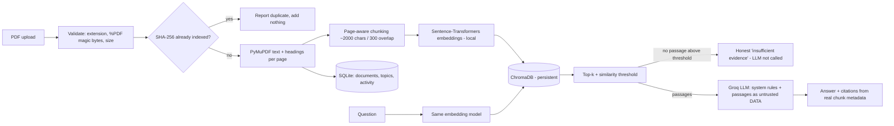

# Document-Based AI Learning Assistant

A local web app that lets you upload PDFs (training notes, syllabi, technical docs), search them by meaning, ask questions and get answers **grounded in the documents with page-level citations**, explore topics, and generate revision quizzes.

> 

**Free vs. possibly paid.** Embeddings, vector search, PDF parsing and storage are all free and run on your PC. Only chat answers and quiz generation call an LLM API (**Groq**, which currently offers a free tier; limits and pricing are set by Groq and may change). Without a Groq key, upload, indexing, search and topics still work.

## Features

| Area | What it does |
|---|---|
| Library | Multi-PDF upload (drag-and-drop), progress, status badges (Pending / Processing / Ready / Failed), details, delete, duplicate detection |
| Knowledge search | Semantic search over all PDFs or selected ones, page numbers, highlighted excerpts. **No LLM needed** |
| AI chat | Answers only from retrieved passages, `[S1]` citations linked to source cards, honest "not enough evidence" replies, suggested questions built from real headings |
| Topic explorer | Headings detected from font styling and numbering (labelled *heuristic*); click one to search it |
| Quiz & revision | Multiple-choice or short-answer questions from retrieved passages, reveal answer, source and page shown, labelled as AI-generated |
| Dashboard | Live statistics and activity read from the database |

## Architecture



Key design decisions:

- **A chunk never spans two pages**, so every citation's page number is exact.
- **Citations come from stored chunk metadata, never from the model.** The model only says "S2"; the backend maps that to the real filename/page, and strips any id it was not given.
- **Two layers against unsupported answers:** (1) a similarity threshold stops the LLM being called at all when nothing relevant is found; (2) the prompt tells the model to reply `INSUFFICIENT_EVIDENCE` if the passages do not contain the answer. Similarity is *not* proof an answer is correct, so the UI shows the sources for you to check.
- **Prompt-injection defence:** retrieved text is wrapped in `<excerpt>` tags, `</` is neutralised so a document cannot close the tag, and the system prompt states excerpts are data, not instructions. This reduces the risk; no prompt defence is perfect.
- **Duplicates:** each file's SHA-256 is stored (unique). Re-uploading identical bytes (even renamed) returns "already indexed" and adds no chunks. A previously *failed* file is retried on its existing record. Chunk ids are `documentId:index` and re-indexing deletes old chunks first, so it is idempotent.
- **Deletion:** vectors are removed first and verified; only then the file and database row. If vector deletion fails, nothing else is deleted so you can retry (no orphans).
- Processing is synchronous inside the upload request (fine for study-sized PDFs). On startup, any document left in Pending/Processing by a crash is marked Failed.
- Chat history is kept in your browser tab (`sessionStorage`), not on the server.

> **Project status and what has been verified:** see [`docs/STATUS.md`](docs/STATUS.md).

## Prerequisites (Windows)

| Tool | Version | Check |
|---|---|---|
| Python | 3.11 or newer (developed and tested on 3.12) | `py --version` |
| Node.js | 18 or newer (tested on 22) | `node --version` |
| Disk / network | ~1 GB free; internet for first install and model download | |

Install Python from python.org (tick **Add python.exe to PATH**) and Node.js LTS from nodejs.org.

## Quick start (Windows, three commands)

From the project folder in PowerShell. `-ExecutionPolicy Bypass` lets these scripts run without changing any Windows setting:

```powershell
powershell -ExecutionPolicy Bypass -File .\scripts\setup.ps1            # once: venv, packages, .env files
powershell -ExecutionPolicy Bypass -File .\scripts\start-backend.ps1    # terminal 1  -> http://localhost:8000
powershell -ExecutionPolicy Bypass -File .\scripts\start-frontend.ps1   # terminal 2  -> http://localhost:5173
```

Prefer to see every step? Sections 1 and 2 below do the same thing by hand. Other helpers: `scripts\run-tests.ps1` (all tests) and `scripts\run-evaluation.ps1` (retrieval measurements).

## 1. Backend setup

Open **PowerShell** in the project folder:

```powershell
cd document-ai-assistant\backend
py -3.11 -m venv .venv          # or: py -m venv .venv
.\.venv\Scripts\Activate.ps1
python -m pip install --upgrade pip
pip install -r requirements-dev.txt
copy .env.example .env
```

If activation says *running scripts is disabled*:

```powershell
Set-ExecutionPolicy -Scope Process -ExecutionPolicy Bypass
.\.venv\Scripts\Activate.ps1
```

The install pulls PyTorch (needed by Sentence-Transformers), so it takes several minutes and a few hundred MB.

### Configure Groq (for chat and quizzes)

1. Create a key at <https://console.groq.com/keys>.
2. Edit `backend\.env` (e.g. `notepad .env`) and set:

```ini
LLM_PROVIDER=groq
GROQ_API_KEY=your-key-here
GROQ_MODEL=openai/gpt-oss-120b
GROQ_REASONING_EFFORT=low
```

> **Model names change.** The earlier default `llama-3.3-70b-versatile` was retired by Groq on 16 August 2026 (per Groq's deprecation page). If your `.env` was copied from an older version and chat says *"Groq does not offer the model ..."*, change `GROQ_MODEL` to a current name from <https://console.groq.com/docs/models> and restart the backend.

`openai/gpt-oss-120b` is a *reasoning* model: it thinks silently before answering, and those thinking tokens count toward the output limit. The app adds headroom for this and sends `reasoning_effort` (`low` by default, which is quicker and cheaper; use `medium` or `high` for harder questions). Both settings are only sent to gpt-oss models. Any other chat model name works too and is sent neither. The key stays in `backend\.env` (git-ignored) and is only ever read by the backend.

### Start the backend

```powershell
uvicorn app.main:app --reload --port 8000
```

Check <http://localhost:8000/health> (`{"status":"ok"}`), <http://localhost:8000/api/v1/ready> and the interactive docs at <http://localhost:8000/docs>. The **first** upload downloads the embedding model (~90 MB) from Hugging Face and may pause for a minute.

## 2. Frontend setup (second PowerShell window)

```powershell
cd document-ai-assistant\frontend
copy .env.example .env
npm install
npm run dev
```

Open <http://localhost:5173>. The sidebar shows whether the backend and chat model are reachable.

## 3. First run: upload the syllabus

1. Go to **Document library**, click **Choose PDF files** and pick the syllabus PDF (or drag it in). Wait for status **Ready** (8 pages, 8 chunks for the provided syllabus).
2. Add more PDFs the same way, one or many at once.
3. Use the scope selector (top of Search / Chat / Quiz) to pick *All documents*, one document, or several.

`docs/syllabus_report.md` holds the inspection report for the provided syllabus (page count, text-based, detected modules). Example questions that exist in that syllabus:

- What are the limitations and risks of using AI in QA?
- How is time saved calculated when comparing manual work with AI?
- What does the governance framework include, such as logging and audit practices?
- What are the final deliverables of the capstone project?
- What does the trainer need to set up for the AI test automation module?
- *(should be declined)* What is the fee for this program? Who is the instructor?

### Two-document demo with the bundled sample PDFs

`samples\` holds two small **synthetic** PDFs (fictional study notes written for this project, labelled as such inside the file): `sample_api_testing_notes.pdf` and `sample_cicd_pipeline_notes.pdf`. Upload both together with the syllabus to demonstrate multi-document search, document filters and deletion. Try:

- *Which HTTP methods are idempotent?* (API notes, page 1)
- *How many automatic retries are allowed for a flaky test?* (CI/CD notes, page 2)
- *What is the p95 latency target?* (API notes, page 3, which also holds a deliberate prompt-injection sentence; the app treats it as ordinary text, so asking about that page never makes the model obey it)
- *(should be declined)* *What is the price of the training course?*

To rebuild the PDFs: `cd backend`, then `python -m evaluation.sample_docs` (writes to `..\samples`).

## 4. Tests

```powershell
# backend (no API key, no internet needed: uses a mock LLM and a test-only hash embedder)
cd backend
pytest

# frontend
cd ..\frontend
npm test
npm run build      # also type-checks
```

The backend suite covers extraction and page numbers, chunking, upload validation, duplicates, deletion and persistence, scoped search, citations, insufficient-evidence handling, prompt-injection handling, quiz generation, the Groq request/error handling (with a fake HTTP layer), vector-store batching and scoring, UTC timestamps, and the two sample PDFs. The frontend suite covers every page plus citation rendering and document filters. `scripts\run-tests.ps1` runs everything and prints one verdict.

One optional test calls the real Groq API. It is excluded from the default run; run it with `pytest -m real_llm` (needs `GROQ_API_KEY`, and uses a tiny amount of Groq quota).

### Retrieval evaluation (do this with the real model)

```powershell
cd backend
python -m evaluation.run_eval --pdf "C:\path\to\syllabus.pdf"
python -m evaluation.run_eval --pdf "C:\path\to\syllabus.pdf" --with-llm   # also checks citations/refusals (uses Groq)
```

To evaluate the two synthetic sample PDFs instead (or as well), use their own labelled dataset, where each question names the expected file and page:

```powershell
python -m evaluation.run_eval --pdf ..\samples\sample_api_testing_notes.pdf ..\samples\sample_cicd_pipeline_notes.pdf --dataset evaluation\sample_dataset.json
```

It prints Recall@5 (is the labelled page in the top 5?), top-1 page accuracy, latency, and a **threshold sweep** showing how many answerable questions are kept versus how many unanswerable ones are rejected at each `MIN_SCORE`. Pick the `MIN_SCORE` in `backend\.env` from that table. The dataset (`evaluation/eval_dataset.json`) uses 16 answerable and 7 unanswerable questions written from the syllabus; each answerable question's page label is verified against the extracted text on every run.

**Read the numbers honestly:** an 8-page document has only 8 chunks, so Recall@5 is easy to score well on (random guessing already lands in the top 5 most of the time). Top-1 accuracy and the unanswerable-rejection column are more informative. The default `MIN_SCORE=0.25` is a starting point, not a measured optimum for the real model.

## Configuration reference (`backend\.env`)

| Variable | Default | Meaning |
|---|---|---|
| `GROQ_API_KEY` | empty | Enables chat and quizzes. Empty = those features show a setup message |
| `GROQ_MODEL` | `openai/gpt-oss-120b` | Groq chat model (names change; see Groq's model list) |
| `GROQ_REASONING_EFFORT` | `low` | `low`/`medium`/`high`; only sent to gpt-oss reasoning models |
| `GROQ_BASE_URL` | `https://api.groq.com/openai/v1` | OpenAI-compatible endpoint |
| `EMBEDDING_MODEL` | `sentence-transformers/all-MiniLM-L6-v2` | Local embedding model |
| `EMBEDDING_BACKEND` | `sentence-transformers` | `hash` is a test double; never use it for real work |
| `DATA_DIR` / `SQLITE_PATH` / `UPLOAD_DIR` / `CHROMA_DIR` | `..\data` | Persistent storage |
| `MAX_UPLOAD_MB`, `MAX_FILES_PER_REQUEST` | 25, 10 | Upload limits |
| `CHUNK_SIZE_CHARS`, `CHUNK_OVERLAP_CHARS` | 2000, 300 | About 500 and 75 tokens (roughly 4 characters per token) |
| `TOP_K`, `MIN_SCORE` | 5, 0.25 | Retrieval size and similarity threshold |
| `CORS_ORIGINS` | `http://localhost:5173,...` | Allowed frontend origins |

Invalid values (for example overlap larger than chunk size) stop the backend at startup with a clear message. Frontend: `VITE_API_BASE_URL` in `frontend\.env`.

## API

`GET /health` · `GET /api/v1/ready` · `POST/GET /api/v1/documents` · `GET/DELETE /api/v1/documents/{id}` · `POST /api/v1/search` · `POST /api/v1/chat` · `GET /api/v1/topics` · `GET /api/v1/suggestions` · `GET /api/v1/stats` · `POST /api/v1/quiz/generate` · `GET /api/v1/quiz/health`

Errors share one shape: `{"error": {"code", "message", "request_id"}}`; every response carries `X-Request-ID`. Chat responses include `answer`, `sources` (filename, page, excerpt), `insufficient_evidence`, `retrieval` (threshold, scores, latency) and `request_id`.

## Troubleshooting

| Problem | Fix |
|---|---|
| `pip install` fails building `chroma-hnswlib` / "Microsoft Visual C++ 14.0 required" | Install *Build Tools for Visual Studio* (C++ workload), reopen PowerShell, retry |
| Install is very slow or fails on `torch` | Retry on a stable connection; or `pip install torch --index-url https://download.pytorch.org/whl/cpu` first, then `pip install -r requirements-dev.txt` |
| Upload shows "Indexing failed... embedding model could not be downloaded" | The first run needs internet access to huggingface.co (check proxy/VPN/firewall). Retry the upload; the failed file is retried on the same record |
| "Scanned PDF" failure | The PDF has no selectable text. OCR is **not** implemented. Use a text-based PDF or OCR it first (e.g. Adobe, `ocrmypdf`) |
| Browser shows a CORS error | Backend must run on the URL in `VITE_API_BASE_URL`; the frontend origin must be in `CORS_ORIGINS`; restart the backend after editing `.env` |
| "Port already in use" | `netstat -ano \| findstr :8000` then `taskkill /PID <pid> /F`, or start with `--port 8001` and update `VITE_API_BASE_URL`. Vite uses 5173 strictly |
| Documents vanished after restart | Check `DATA_DIR`. Do not delete `data\app.db` or `data\chroma` separately; remove both together to reset |
| Chat says "GROQ_API_KEY is not set" | Put the key in `backend\.env` (not `.env.example`), restart the backend, and confirm the sidebar shows a chat model |
| Chat says "Groq does not offer the model ..." | The model in `GROQ_MODEL` was retired (the old default `llama-3.3-70b-versatile` was, on 2026-08-16). Set a current name from Groq's model list, restart the backend |
| "The model ran out of output tokens" | Rare with the default settings. Retry, and keep `GROQ_REASONING_EFFORT=low` |
| Upload times look off by a few hours | Fixed in this version (timestamps are sent as UTC and shown in your local time). Hard-refresh the browser if you still see old behaviour |
| Groq 401 / 429 / model error | 401: key wrong. 429: rate limit, wait. Other: check `GROQ_MODEL` is available to your account |
| Answers say "not enough evidence" for questions that *are* in the PDF | Threshold too strict for your model; lower `MIN_SCORE` (use the evaluation sweep) or rephrase |
| Backend log is noisy / you need a trace | Set `LOG_LEVEL=DEBUG`; quote the `request_id` from the error |

## Security and data handling

- API keys live only in `backend\.env`; they are never sent to the browser, never hardcoded, and log lines that look like keys are redacted.
- Uploaded files are stored under random internal names (`<uuid>.pdf`); the original filename is display-only. Only `.pdf` with `%PDF-` content, within the size and count limits, is accepted.
- Uploaded PDFs, the database and the vector store stay on your machine (`data\`, git-ignored). **When you ask a question, the retrieved passages (and for quizzes, sampled passages) are sent to Groq.** Do not index confidential or personal data unless that is acceptable under your organisation's policy.
- There is no authentication or multi-user separation: run it locally for yourself only.
- Errors never include stack traces or secrets; tracebacks go to the server log only.

## Limitations and ideas

- Text-based PDFs only (no OCR). Tables are indexed as text but flattened; heading detection skips table cells.
- Topic detection is heuristic (font style + numbering) and may miss or mislabel headings in unusual layouts.
- Quiz questions are AI-written; the app verifies each question points to a real retrieved passage but cannot verify the question itself is correct. Always check the source shown.
- Single-user, synchronous indexing, chat history only in the browser tab.
- Possible next steps: OCR, hybrid keyword + vector search, re-ranking, background ingestion queue, server-side chat history, streaming answers.

## Repository layout

```
document-ai-assistant/
  backend/   app/{core,db,schemas,services,api/routes,tests}  evaluation/  requirements*.txt  .env.example
  frontend/  src/{api,components,pages,hooks,types,test}  package.json  .env.example
  data/      uploads/  chroma/  (git-ignored contents)
  samples/   two synthetic demo PDFs
  scripts/   Windows PowerShell helpers (setup, start, test, evaluate)
  docs/      syllabus_report.md  STATUS.md
  README.md  .gitignore
```

## 5-minute demo script

1. Dashboard: show the empty state and the "no Groq key" notice if applicable.
2. Library: upload the syllabus plus the two PDFs from `samples\`; show statuses, then re-upload the syllabus to show the duplicate message.
3. Search (scope: All): *"self-healing automation"*; point out filename, page, highlighted excerpt. Switch scope to one document.
4. Chat: ask *"What are the limitations and risks of using AI in QA?"*; click the `S1` chip to jump to its source card. Then ask *"What is the fee for this program?"* and show the honest refusal.
5. Topic explorer: click *Module 6* to search it. Quiz: generate 3 questions, reveal an answer, show its source page.
6. Library: delete `sample_cicd_pipeline_notes.pdf`, then search *"flaky test retries"* to show its content is gone.
